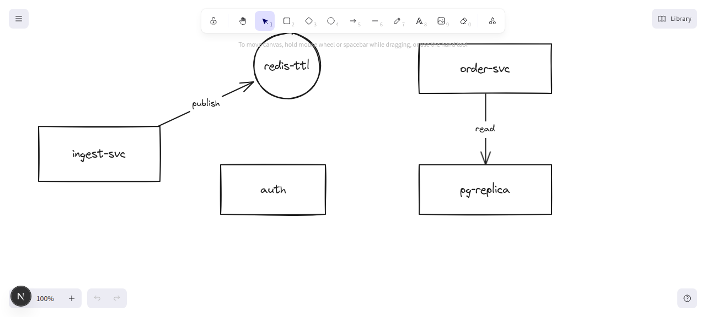

# retrace

Draw a diagram by hand — boxes, arrows, labels — press one button, and get a **real
Excalidraw diagram** back: every box draggable, every arrow bound to what it points at,
every label editable text.

Not a picture of your sketch. Not a tidy template that no longer looks like what you
drew. Native elements, in the positions you drew them.



## Status

Early. The conversion core works and is tested; the AI that produces the graph is next.

**Working today**

- `DiagramGraph` — one intermediate representation, shared by every input door
- Graph → Excalidraw elements, with bound arrows and bound (editable) text labels
- Spatial fidelity: elements land where they were drawn, snapped to a 10-unit grid.
  We never re-layout your diagram — the arrangement is your decision, not ours
- 12 tests over the conversion logic (pure, no DOM required)

**Not built yet**

- Model calls: sketch → graph, photo → graph, chat → graph
- "Make it real" on a freedraw selection inside the editor
- BYOK provider settings UI
- Scene persistence and share links

## How it works

The pipeline is deliberately one-way and narrow:

```
image / freedraw / prompt
        │
        ▼
  DiagramGraph  { nodes: [{id, label, shape, bbox}], edges: [{from, to, label}] }
        │        ← the model's only output. Validated with zod. Never raw element JSON.
        ▼
   skeleton      ← pure TS: ids, positions, bindings, warnings
        │
        ▼
Excalidraw elements   ← @excalidraw/excalidraw's own factory fills in the rest
```

Two rules that drive the design:

1. **The model emits a graph, never elements.** Free-form element JSON from an LLM is
   unvalidatable and unlayoutable. A node/edge graph is checkable, and a deterministic
   converter turns it into a scene.
2. **Geometry is cheap, semantics are expensive.** Snapping a sloppy rectangle to a
   real one is maths. Deciding *what the rectangle is* and *what it connects to* is the
   AI's job. Mixing the two wastes the model on the easy half.

## Development

```bash
npm install
npm run dev      # http://localhost:3000
npm test         # conversion tests
npm run typecheck
```

`src/lib/diagram/` holds the conversion. It is pure TypeScript on purpose — if a test
ever needs a browser, something browser-only has leaked into the wrong module.
`to-elements.ts` is the single file allowed to import Excalidraw, and it does so lazily.

Fixtures live in `fixtures/`. `fixtures/graph-sketch2.json` is a graph read off a
hand-drawn sketch by a vision model, kept as the regression case.

## Roadmap

BYOK is a design requirement, not an afterthought: bring your own key, pick your
provider. Planned support is OpenAI, Anthropic, Google Gemini, OpenRouter, and any
OpenAI-compatible endpoint (which covers OpenCode, Ollama, LM Studio, vLLM and friends).

## License

MIT
